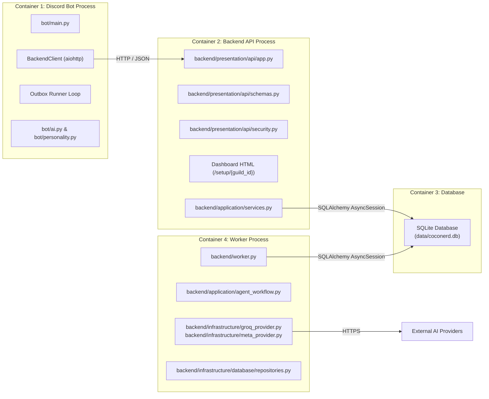
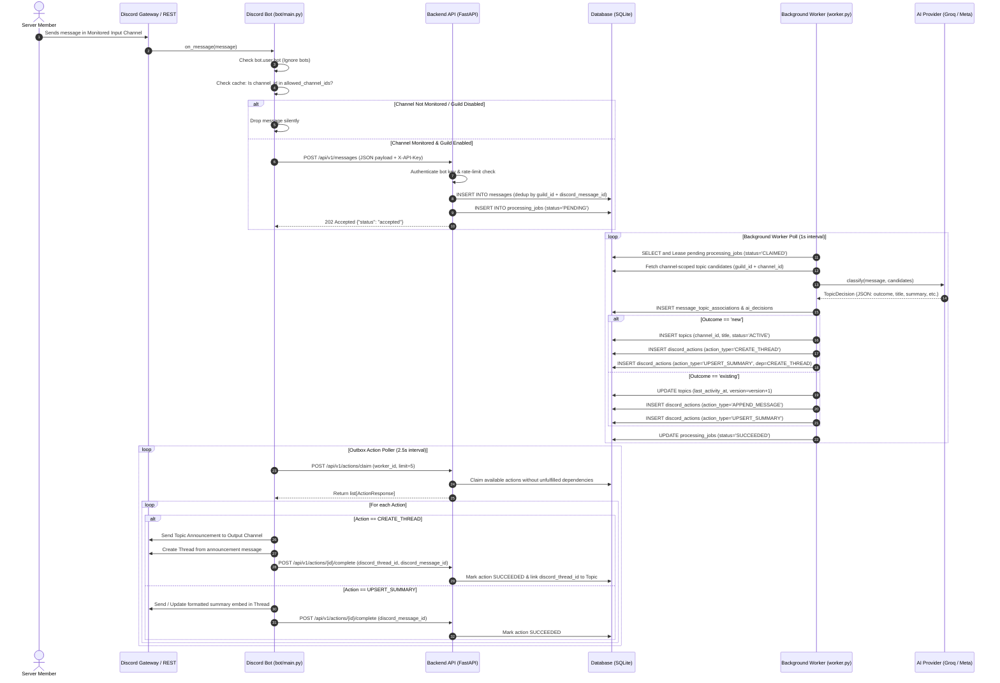
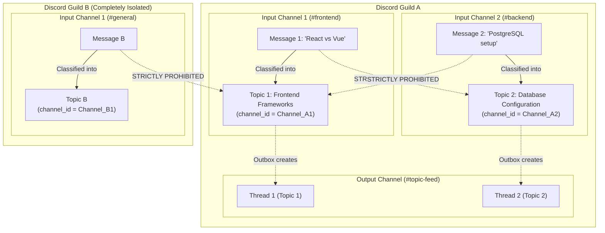
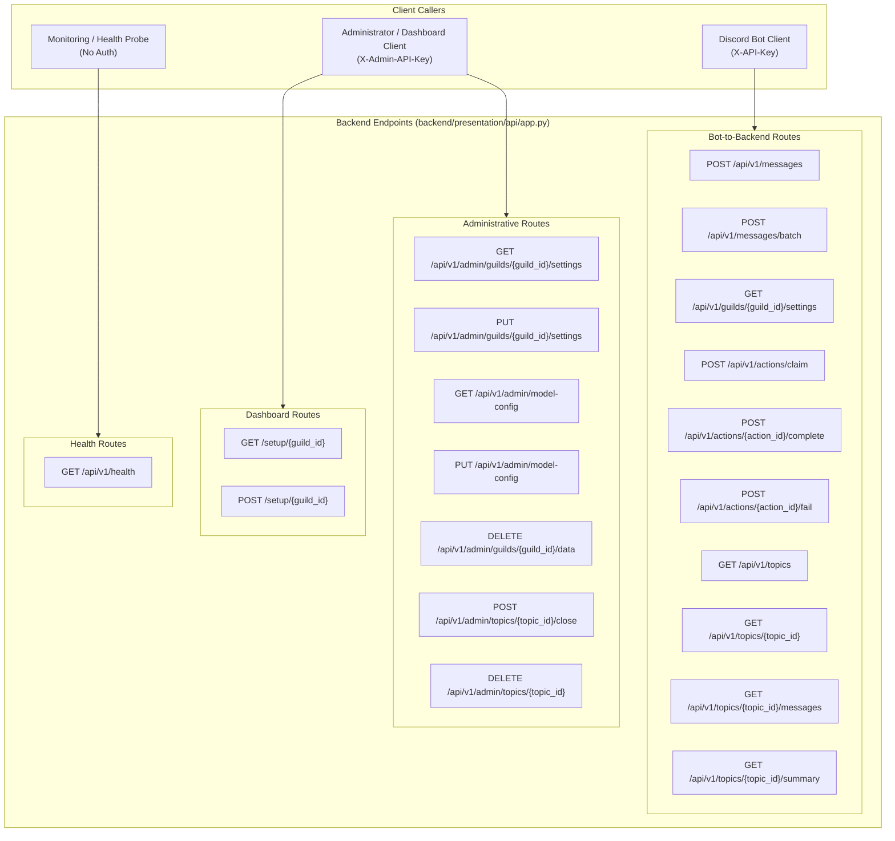
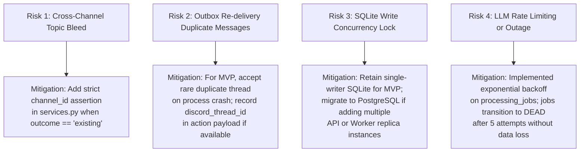

# Coconerd — System Architecture Documentation (MVP v0.1)

> **Document Version:** 1.0.0  
> **Status:** Architecture Audit & System Specification (M1)  
> **Date:** November 2026  
> **Repository:** `d:\explode\metaAI\coconerd`

---

## 1. System Context Diagram

Coconerd is an autonomous conversation organizer for Discord servers. It monitors multiple high-volume discussion channels, ingests conversations into a centralized backend, classifies messages into channel-scoped topics using AI, and outputs organized discussion threads and summaries to a single dedicated output channel.

```mermaid
flowchart TD
    subgraph Discord["Discord Platform"]
        subgraph Guild["Discord Server (Guild)"]
            IC1["Input Channel 1<br>(e.g. #general)"]
            IC2["Input Channel 2<br>(e.g. #dev-chat)"]
            ICN["Input Channel N<br>(Configured Monitored Channels)"]
            OC["Output Channel<br>(Single Configured Channel)"]
            AdminUser["Server Administrator"]
            MemberUser["Server Members"]
        end
        Gateway["Discord Gateway (WebSocket)"]
        DiscordREST["Discord REST API"]
    end

    subgraph CoconerdBot["Coconerd Discord Bot (bot/main.py)"]
        BotGateway["Gateway Client & Event Handlers"]
        SlashRouter["Slash Commands (/setup, /summarize, /ping)"]
        OutboxPoller["Outbox Action Processor (Background Task)"]
        AllowlistCache["In-Memory Guild Settings Cache (30s TTL)"]
    end

    subgraph BackendAPI["Backend Service (FastAPI)"]
        APIRouter["FastAPI REST Endpoints (/api/v1)"]
        AuthRateLimit["Auth & Sliding Window Rate Limiting"]
        DashboardUI["Web Setup Dashboard (/setup/{guild_id})"]
        IngestService["Ingest & Job Creator Service"]
    end

    subgraph Persistence["Storage Layer"]
        DB[(Database: SQLite / aiosqlite)]
    end

    subgraph WorkerService["Backend Worker (backend/worker.py)"]
        WorkerQueue["Job Lease Manager"]
        LangGraphWorkflow["Classification StateGraph"]
        SummaryEngine["Incremental Memory Engine"]
    end

    subgraph AIProviders["External AI Provider"]
        GroqAPI["Groq Cloud API<br>(llama-3.3-70b-versatile / gpt-oss-20b)"]
        MetaAPI["Meta Model API / Compatible Endpoint<br>(muse-spark-1.3)"]
    end

    %% Interactions
    MemberUser -->|Sends messages| IC1 & IC2 & ICN
    AdminUser -->|Executes /setup| SlashRouter
    AdminUser -->|Configures Channels| DashboardUI
    DashboardUI -->|PUT /api/v1/admin/guilds/{id}/settings| APIRouter

    IC1 & IC2 & ICN -->|Message Events| Gateway
    Gateway -->|on_message| BotGateway
    BotGateway -->|Validate against| AllowlistCache
    AllowlistCache -.->|GET /api/v1/guilds/{id}/settings| APIRouter
    BotGateway -->|POST /api/v1/messages| APIRouter

    APIRouter -->|Persist Message & Job Transactionally| DB
    WorkerQueue -->|Poll & Claim Job Lease| DB
    WorkerQueue -->|Execute Classification| LangGraphWorkflow
    LangGraphWorkflow -->|JSON Schema Prompt| GroqAPI
    LangGraphWorkflow -.->|Fallback / Alternative| MetaAPI
    WorkerQueue -->|Write Topic, Summary & Actions| DB

    OutboxPoller -->|POST /api/v1/actions/claim| APIRouter
    APIRouter -->|Fetch Claimable Actions| DB
    OutboxPoller -->|Create Thread & Post Summary| DiscordREST
    DiscordREST -->|Publish Threads & Notifications| OC
    OutboxPoller -->|POST /api/v1/actions/{id}/complete| APIRouter
    APIRouter -->|Mark Action SUCCEEDED| DB
```

---

## 2. Container / Component Architecture

The actual implementation strictly maintains decoupled boundaries between Discord transport, backend business logic, persistent storage, worker execution, and AI providers.



### Component Boundaries & Responsibilities

| Component | Actual File Location | Primary Responsibility | Input / Output | Runtime Dependencies |
| :--- | :--- | :--- | :--- | :--- |
| **Discord Bot** | `bot/main.py` | • Connects to Discord Gateway.<br>• Validates incoming messages against cached channel allowlists.<br>• Forwards monitored messages to Backend API.<br>• Polls and executes outbound actions (creating threads, posting summaries to Output Channel).<br>• Serves `/setup`, `/summarize`, and `/ping` slash commands. | **In:** Discord Gateway events, slash interactions.<br>**Out:** Discord REST calls, HTTP requests to Backend API. | `discord.py` 2.7.1, `aiohttp`, `python-dotenv` |
| **Banter Persona (Prototype)** | `bot/ai.py`<br>`bot/personality.py` | Standalone humorous/sarcastic mention replies when bot is directly tagged in chat. *Does not perform topic management.* | **In:** User mention text.<br>**Out:** Banter reply string. | `groq`, `discord.py` |
| **Backend API** | `backend/presentation/api/app.py` | • Enforces payload limits and constant-time API key auth (`X-API-Key`, `X-Admin-API-Key`).<br>• Ingests messages into durable storage with processing jobs.<br>• Manages Outbox action leases and acknowledgments.<br>• Serves topic summaries and admin settings.<br>• Hosts embedded web setup dashboard (`/setup/{guild_id}`). | **In:** HTTP requests from Bot and Admins.<br>**Out:** JSON responses, HTML dashboard. | `FastAPI`, `uvicorn`, `pydantic`, `SQLAlchemy` |
| **Application Services** | `backend/application/services.py`<br>`backend/application/agent_workflow.py` | • Transactional message ingestion.<br>• Compiles LangGraph StateGraph for classification routing.<br>• Topic candidate filtering and duplicate title reconciliation.<br>• Incremental summary merging and Outbox action generation. | **In:** Normalized entities, repository instances.<br>**Out:** Domain entity updates, Outbox records. | `langgraph`, `pydantic` |
| **Database Repositories & Models** | `backend/infrastructure/database/models.py`<br>`backend/infrastructure/database/repositories.py` | • 12 SQLAlchemy ORM mapped tables.<br>• Abstract query interfaces for Messages, Topics, Summaries, Actions, and Jobs. | **In:** Domain entities & filter criteria.<br>**Out:** Persistent database records. | `SQLAlchemy` 2.0 (asyncio), `aiosqlite` |
| **Background Worker** | `backend/worker.py` | • Independent daemon polling durable `processing_jobs`.<br>• Executes AI model classification per message.<br>• Updates topic lifecycles and generates outbox actions.<br>• Executes periodic retention pruning and dormant topic transitions. | **In:** Unleased processing jobs from DB.<br>**Out:** Updated associations, AI decisions, Outbox records. | `asyncio`, `SQLAlchemy`, `langgraph` |
| **AI Model Providers** | `backend/infrastructure/groq_provider.py`<br>`backend/infrastructure/meta_provider.py` | Concrete adapters implementing `ModelProvider` protocol: classifies messages into structured `TopicDecision` JSON (`new`, `existing`, `defer`, `irrelevant`) and generates topic summaries. | **In:** `ConversationMessage`, `list[TopicCandidate]`.<br>**Out:** `TopicDecision`, summary dictionaries. | `groq` SDK, `httpx` (Meta OpenAI-compatible endpoint) |

---

## 3. Message Lifecycle

The lifecycle follows an asynchronous, durable pipeline where the Discord Gateway listener is completely decoupled from AI classification and thread creation.



### Lifecycle Implementation Audit

| Step | Lifecycle Stage | Current Implementation Status | Source Verification |
| :---: | :--- | :--- | :--- |
| **1** | Discord Gateway message reception | **Implemented** | `bot/main.py:497` (`on_message`) |
| **2** | Bot checks Guild and Channel Allowlist | **Implemented** | `bot/main.py:514` (Reads from 30s TTL cache) |
| **3** | Bot normalizes message data | **Implemented** | `bot/main.py:148` (Extracts ISO-8601 UTC timestamp, IDs, reply reference) |
| **4** | Bot forwards message to Backend | **Implemented** | `bot/main.py:165` (`POST /api/v1/messages`) |
| **4b** | Bot batch forwarding | **Not Implemented in Bot** *(Backend endpoint `POST /api/v1/messages/batch` exists, but bot sends single items)* | `backend/presentation/api/app.py:199` |
| **5** | Backend authenticates & validates payload | **Implemented** | `backend/presentation/api/security.py:8`, `app.py:166` |
| **6** | Backend deduplicates & persists message + job | **Implemented** | `backend/application/services.py:46` (`ingest_message`) |
| **7** | AI Worker classifies into channel-scoped topics | **Implemented** | `backend/worker.py:108`, `groq_provider.py:73` |
| **8** | Backend creates transactional Outbox actions | **Implemented** | `backend/application/services.py:213` (`CREATE_THREAD`, `APPEND_MESSAGE`, `UPSERT_SUMMARY`) |
| **9** | Bot retrieves and executes pending actions | **Implemented** | `bot/main.py:290` (`process_outbox_actions`) |
| **10** | Backend receives completion / failure acknowledgment | **Implemented** | `backend/presentation/api/app.py:347` (`/complete`), `app.py:385` (`/fail`) |

---

## 4. Topic Isolation Architecture

### Core Invariant
$$\text{Topic} \in \text{Guild} \times \text{Discord Channel}$$
*A Topic belongs to exactly one Discord Guild and exactly one Discord Input Channel. Messages from Channel A must never merge into, link with, or influence Topics originating from Channel B.*



### Prevention Mechanisms & Current Code Verification

1. **Cross-Guild Isolation:**
   - Every database query in `repositories.py` (`MessageRepository`, `TopicRepository`, `SummaryRepository`, `ActionRepository`) explicitly filters by `guild_id`.
   - In `backend/application/services.py:127`:
     ```python
     topic = await topics.get(message.guild_id, decision.topic_id)
     if topic is None or topic.status == TopicStatus.CLOSED:
         decision.outcome = "defer"
     ```
     If the AI proposes a `topic_id` from another Guild, the lookup returns `None` and the decision is deferred.

2. **Cross-Channel Isolation:**
   - `TopicRecord` in `backend/infrastructure/database/models.py:70` contains `channel_id: Mapped[str | None]`.
   - `TopicRepository.candidates(guild_id, channel_id)` in `backend/infrastructure/database/repositories.py:65`:
     ```python
     stmt = select(TopicRecord).where(
         TopicRecord.guild_id == guild_id,
         TopicRecord.status.in_([TopicStatus.ACTIVE.value, TopicStatus.DORMANT.value, TopicStatus.RESUMED.value]),
     )
     if channel_id:
         stmt = stmt.where(TopicRecord.channel_id == channel_id)
     ```
     The AI is *only provided topic candidates that were created in the exact same input channel*.
   - When creating a new topic (`backend/application/services.py:149`):
     ```python
     topic_entity = ConversationTopic.create(message.guild_id, decision.title, channel_id=message.channel_id)
     ```
     The source `channel_id` is permanently bound to the created `TopicRecord`.

3. **Duplicate Ingestion Prevention:**
   - `MessageRecord` contains `UniqueConstraint("guild_id", "discord_message_id", name="uq_message_guild_discord_id")`.
   - `ingest_message()` checks for existing message ID. If present, it skips creating a duplicate message or processing job.

### Identified Architectural Gaps in Topic Isolation
1. **Model Fallback Cross-Channel Validation Gap:**
   In `backend/application/services.py:126-130`, if `decision.outcome == "existing"`, the backend validates `topics.get(message.guild_id, decision.topic_id)`, but **does not explicitly assert** `topic.channel_id == message.channel_id`. If an LLM hallucinates an existing `topic_id` across channels within the same guild, the code would currently accept it.
2. **Nullable Channel Column:**
   `TopicRecord.channel_id` is currently `nullable=True` (retained for backward compatibility with initial schema). For strict isolation, it should be migrated to `nullable=False`.
3. **Missing Composite Index:**
   The database lacks an index on `(guild_id, channel_id, status)`. As message volumes grow, candidate lookups will scan the entire guild's topics rather than jumping directly to the channel's active topics.

---

## 5. API and Integration Boundaries

All API routes are served under prefix `/api/v1` (with the exception of `/setup/{guild_id}`). All endpoints require authentication via constant-time header matching, except public health checks.



### Complete Endpoint Specification

| Method | Endpoint Route | Auth Dependency | Status | Description |
| :--- | :--- | :--- | :--- | :--- |
| `GET` | `/api/v1/health` | None | **Implemented** | Database ping and worker heartbeat freshness check. |
| `POST` | `/api/v1/messages` | `X-API-Key` (Bot) | **Implemented** | Ingests a single message; creates a durable `processing_job`. |
| `POST` | `/api/v1/messages/batch` | `X-API-Key` (Bot) | **Implemented** | Ingests up to 50 messages in one request; skips disallowed channels. |
| `GET` | `/api/v1/guilds/{guild_id}/settings` | `X-API-Key` (Bot) | **Implemented** | Bot reads `allowed_channel_ids` and `output_channel_id`. |
| `POST` | `/api/v1/actions/claim` | `X-API-Key` (Bot) | **Implemented** | Claims up to `limit` unleased actions whose dependencies succeeded. |
| `POST` | `/api/v1/actions/{action_id}/complete` | `X-API-Key` (Bot) | **Implemented** | Acknowledges action execution; updates Discord thread/message IDs. |
| `POST` | `/api/v1/actions/{action_id}/fail` | `X-API-Key` (Bot) | **Implemented** | Reports action failure; schedules backoff retry or marks `DEAD`. |
| `GET` | `/api/v1/topics` | `X-API-Key` (Bot) | **Implemented** | Lists recent topics for a guild and optional channel. |
| `GET` | `/api/v1/topics/{topic_id}` | `X-API-Key` (Bot) | **Implemented** | Returns topic metadata and current thread ID. |
| `GET` | `/api/v1/topics/{topic_id}/messages` | `X-API-Key` (Bot) | **Implemented** | Lists message records classified into a specific topic. |
| `GET` | `/api/v1/topics/{topic_id}/summary` | `X-API-Key` (Bot) | **Implemented** | Retrieves latest version of structured topic summary. |
| `GET` | `/api/v1/admin/guilds/{guild_id}/settings` | `X-Admin-API-Key` | **Implemented** | Admin reads guild configuration. |
| `PUT` | `/api/v1/admin/guilds/{guild_id}/settings` | `X-Admin-API-Key` | **Implemented** | Sets `allowed_channel_ids`, `output_channel_id`, `enabled`, `retention_days`. |
| `GET` | `/api/v1/admin/model-config` | `X-Admin-API-Key` | **Implemented** | Retrieves guild or global AI model configuration. |
| `PUT` | `/api/v1/admin/model-config` | `X-Admin-API-Key` | **Implemented** | Sets provider (`groq` or `meta`), model ID, temperature, max tokens. |
| `DELETE`| `/api/v1/admin/guilds/{guild_id}/data` | `X-Admin-API-Key` | **Implemented** | Cascading hard-delete of all guild data. |
| `POST` | `/api/v1/admin/topics/{topic_id}/close` | `X-Admin-API-Key` | **Implemented** | Transitions topic status to `CLOSED`. |
| `DELETE`| `/api/v1/admin/topics/{topic_id}` | `X-Admin-API-Key` | **Implemented** | Hard-delete of a specific topic and associated records. |
| `GET` | `/setup/{guild_id}` | None (Key in form) | **Implemented** | Interactive HTML dashboard to configure guild channels. |
| `POST` | `/setup/{guild_id}` | Form `admin_key` | **Implemented** | Fallback HTML form submission for dashboard. |

---

## 6. Background Worker and Outbox Pattern

### 6.1 Worker Queue Processing
1. **Lease Acquisition:**
   `ConversationWorker` executes in a continuous loop. On each tick (default: 1s), it queries `processing_jobs` for the oldest record where:
   $$\text{status} = \text{'PENDING'} \quad \text{AND} \quad \text{available\_at} \le \text{utcnow()}$$
   It leases the job by setting `status = 'CLAIMED'`, `lease_owner = worker_id`, and `lease_expires_at = utcnow() + 60\text{s}`.
2. **Execution & Concurrency:**
   Within the lease window, the worker calls `process_message_record()`. Optimistic locking on `TopicRecord.version` prevents concurrent updates to the same topic.
3. **Failure & Bounded Backoff:**
   If processing raises an unhandled exception, `_fail_job()` calculates an exponential backoff:
   $$\text{delay} = \min(300, 2^{\min(\text{attempt\_count}, 8)}) \text{ seconds}$$
   If `attempt_count < max_attempts` (default: 5), status reverts to `PENDING` with updated `available_at`. Otherwise, status transitions to `DEAD`.

### 6.2 Outbox Action Processing
1. **Transactional Enqueue:**
   Outbox actions (`discord_actions`) are inserted within the **exact same database transaction** that updates topics and summaries. An action can never exist without its corresponding domain mutation.
2. **Dependency Resolution:**
   An action with a `dependency_id` (e.g. `UPSERT_SUMMARY` depending on `CREATE_THREAD`) cannot be claimed until the parent action's status is `SUCCEEDED`.
3. **Bot Action Execution & Lease:**
   The bot claims up to 5 actions via `POST /api/v1/actions/claim`. The backend sets `status = 'CLAIMED'` and assigns an expiration lease.
4. **Duplicate Discord Message Analysis (Idempotency Assessment):**
   - **Scenario:** The bot claims a `CREATE_THREAD` action, calls Discord API, and successfully creates the thread. Before the bot can call `/complete`, the bot process crashes or the network drops.
   - **Result:** The lease expires after 60s. The action reverts to available status. A restarted bot will re-claim the action and call `target_channel.send()` a second time, creating a duplicate thread in Discord.
   - **Current Mitigation:** Minimal. Once `/complete` is called, repeat completions with matching thread IDs are accepted safely (`app.py:350`). However, Discord REST calls themselves are not idempotent.

---

## 7. Current State vs Target MVP (Gap Analysis)

| Requirement / Component | Current Implementation in Repository | Status | Gap / Recommended Next Action |
| :--- | :--- | :--- | :--- |
| **Multi-channel Ingestion** | Bot monitors multiple `allowed_channel_ids`, verifies against cached allowlist, and submits messages to Backend. | **Implemented** | Working as designed. |
| **Single Output Channel** | Backend stores `output_channel_id` in `guild_settings`. Bot routes thread creations and summaries to this channel. | **Implemented** | Working as designed. |
| **Topic Channel Isolation** | `channel_id` is stored on `TopicRecord` and passed to candidate queries. Candidate search isolates by channel. | **Partially Implemented** | Backend does not explicitly verify `topic.channel_id == message.channel_id` when model returns `outcome="existing"`. Must add assertion. |
| **Message Deduplication** | Database constraint on `(guild_id, discord_message_id)`. Duplicate ingestion returns `202 Accepted` idempotently. | **Implemented** | Working as designed. |
| **Batch Message Ingestion** | `POST /api/v1/messages/batch` implemented in API. Bot only sends single messages via `POST /messages`. | **Partially Implemented** | Bot should implement an in-memory queue that flushes every 1-2 seconds or 20 messages. |
| **AI Classification Engine** | `GroqModelProvider` implemented with JSON mode, classifying into `new`, `existing`, `defer`, `irrelevant`. | **Implemented** | Verified working with `llama-3.3-70b-versatile`. |
| **Incremental Summaries** | Summaries track `overview`, `decisions`, `proposals`, `action_items`, `open_questions`, and version history. | **Implemented** | Working as designed. |
| **Outbox Action Execution** | Bot background runner polls actions, creates public threads, posts summaries, and acknowledges completion. | **Implemented** | Working as designed. |
| **Discord Slash Commands** | Native `discord.app_commands` with `/setup`, `/summarize`, `/ping` using guild-scoped synchronization. | **Implemented** | Commands appear immediately in guild. |
| **Admin Setup Dashboard** | Embedded Dark-mode web interface at `/setup/{guild_id}` for channel configuration. | **Implemented** | Self-contained, zero additional frontend dependency. |
| **Direct LLM Call Separation** | Core topic processing is strictly owned by Backend Worker. (Bot only uses LLM for experimental mention banter). | **Implemented** | Clean boundary maintained. |
| **Alembic Database Migrations** | Initial migrations exist in `alembic/versions`, but API relies on `Base.metadata.create_all` on startup. | **Partially Implemented** | Align migration scripts with `output_channel_id` and `channel_id` schema additions before production. |

---

## 8. Architecture Risks and Decisions

### 8.1 Key Risks & MVP Mitigations



1. **Channel-Level Data Isolation Risk:**
   *Observation:* If an LLM returns an existing `topic_id` that belongs to another channel within the same server, `services.py` currently verifies guild ownership but omits channel ownership verification.  
   *Hackathon Recommendation:* Add a 2-line check in `backend/application/services.py:127`:
   ```python
   if topic is None or topic.status == TopicStatus.CLOSED or topic.channel_id != message.channel_id:
       decision.outcome = "defer"
   ```

2. **Outbox Idempotency & Duplicate Discord Messages:**
   *Observation:* Discord's REST API does not support idempotency tokens for channel message creation. If the bot crashes between `target_channel.send()` and `/api/v1/actions/{id}/complete`, a duplicate thread will be posted when the lease expires.  
   *Hackathon Recommendation:* This is acceptable for an MVP. For production, the bot should persist a local dispatch journal or search the channel for a thread matching the topic title before re-creating.

3. **Database Write Serialization (SQLite):**
   *Observation:* SQLite under `aiosqlite` serializes write transactions. During concurrent message ingestion, action claims, and worker commits, SQLite may throw `database is locked` under high burst load.  
   *Hackathon Recommendation:* Ensure SQLite `busy_timeout` is set to `30000` (30 seconds) and WAL mode (`PRAGMA journal_mode=WAL`) is enabled. Keep SQLite for local hackathon demo; do not prematurely introduce PostgreSQL infrastructure unless multi-container scaling is required.

4. **Bot Batching Delivery:**
   *Observation:* High-volume Discord channels fire tens of messages per second. Ingesting each message with an individual HTTP request incurs unnecessary network and connection overhead.  
   *Hackathon Recommendation:* Implement a lightweight message buffer in `bot/main.py` using `asyncio.Queue` that flushes to `POST /api/v1/messages/batch` every 1.5 seconds or when 20 messages accumulate.

5. **LLM Structured Output Reliability:**
   *Observation:* When candidate lists exceed 20 topics, LLM token limits and response latency increase.  
   *Hackathon Recommendation:* Candidate search is currently limited to 30 topics (`limit=30`). For MVP, capping at the top 10 most recently active topics per channel yields faster Groq response times and higher classification precision.

---

## 9. Technology Stack Summary (As-Built)

- **Discord Bot:** Python 3.12, `discord.py` 2.7.1, `aiohttp` 3.11.
- **Backend Framework:** FastAPI 0.115, Uvicorn, Pydantic 2.10, Pydantic Settings.
- **Workflow & AI Orchestration:** LangGraph 0.3, Groq SDK 0.11 (model: `llama-3.3-70b-versatile`), Meta Model API adapter (httpx).
- **Persistence:** SQLAlchemy 2.0 (AsyncIO), SQLite with `aiosqlite`.
- **Dashboard:** Server-side rendered responsive HTML/CSS/JavaScript served directly via FastAPI (`/setup/{guild_id}`).
